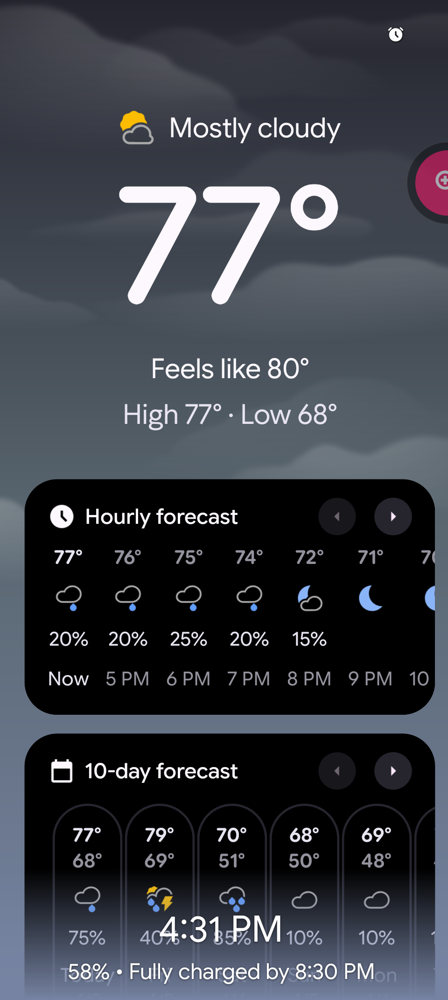

# Longevity Stack Tracker

A Flutter app for tracking evidence-based longevity protocols: supplements, exercise, and wellness routines optimized for healthspan extension. Built with the Forest Night design system for calm, non-judgmental daily tracking.

## Features

✅ **Evidence-Based Supplement Tracking** - Importance-ranked supplements (Tier 1-4) based on human RCTs  
✅ **Exercise Protocol Management** - Zone 2, VO2 max, strength training, joint mobility  
✅ **Expandable Task Cards** - Tap to view detailed supplement lists, exercise sets/reps, instructions  
✅ **Calendar History View** - Color-coded completion tracking with monthly navigation  
✅ **Opt-In/Out System** - Enable/disable supplements and exercises in Settings  
✅ **Smart Timing Rules** - Circadian-aligned supplement timing (morning, with meals, before bed, autophagy days)  
✅ **Sunrise/Sunset Notifications** - Location-aware notifications using NREL astronomical calculations  
✅ **Forest Night Theme** - Calm dark mode with soft greens and earth tones  
✅ **Non-Judgmental Design** - Skip tasks without shame; completion stats, not failure counts  

## Design Philosophy

**Forest Night Theme:** A peaceful, supportive environment for daily longevity rituals
- 🌲 **Calm & Natural** - Soft forest greens, muted earth tones for evening use
- 🎨 **Soft Contrast** - Easy on eyes during long tracking sessions
- ✨ **Non-Judgmental** - "Skip" is neutral grey, not red/negative
- 🔄 **Consistent** - Systematic spacing, typography, and colors
- 🌙 **Circadian-Aware** - Supplement timing aligned with chronobiology

**Evidence-Based:** All supplement recommendations backed by human clinical trials, meta-analyses, and longevity researcher consensus (Sinclair, Attia, Patrick).

## Longevity Science Integration

### Supplement Importance Tiers

**Tier 1 (Critical Foundation):** Strong human evidence, proven mortality reduction
- Vitamin D3 (10/10) - 25% mortality reduction
- Magnesium (9/10) - DNA repair, 300+ enzymes
- Omega-3 (8/10) - Anti-inflammaging, cardiovascular

**Tier 2 (High Priority):** Good evidence, clear mechanisms
- Creatine, Sulforaphane, Zinc, K2, Spermidine (6-7/10)

**Tier 3-4 (Experimental/Speculative):** Limited human data or poor bioavailability
- NMN/NR, CoQ10, Quercetin (4-5/10)
- Resveratrol, Curcumin (2-3/10)

See `SUPPLEMENT_GUIDE.md` for complete tier system with dosing and timing recommendations.

### Exercise Protocols

- **Zone 2 Cardio** - Mitochondrial biogenesis, metabolic flexibility
- **VO2 Max Intervals** - Strongest predictor of mortality and healthspan
- **Strength Training** - Sarcopenia/osteosarcopenia prevention
- **Joint Sequences** - Injury prevention, movement quality
- **Breathing Protocols** - Parasympathetic activation

See `exercise_definitions.md` and `GLOSSARY.md` for detailed protocol definitions.

## Screenshots



> Run `flutter run -d linux` to see the app in action!

## Getting Started

### Prerequisites

- Flutter SDK 3.41.6+ with Dart 3.11.4
- Android Studio / Xcode (for mobile development)
- Linux desktop dependencies (for desktop build): `mesa-utils`, `libglu1-mesa`
- A physical device or emulator

### Installation

```bash
# Clone the repository
cd longevity

# Install dependencies
flutter pub get

# Run the app
flutter run
```

### Supported Platforms

- ✅ Android
- ✅ iOS
- ✅ Linux (requires system dependencies)
- ✅ Windows
- ✅ macOS
- ✅ Web

## Project Structure

```
lib/
├── models/              # Data models (tasks, schedules)
├── screens/             # UI screens (Today, History)
├── services/            # Business logic (database, tasks)
├── theme/               # Forest Night theme configuration
├── utils/               # Helper utilities (icons, etc.)
└── main.dart            # App entry point

assets/
├── icons/               # Custom SVG category icons
└── backgrounds/         # Gradients and textures

docs/
├── FOREST_NIGHT_DESIGN_SYSTEM.md
├── ui_guidelines.md
├── PLATFORM_COMPATIBILITY.md
└── DESIGN_IMPLEMENTATION_SUMMARY.md
```

## Usage

### Today Screen

- View all tasks scheduled for today (supplements, exercises, wellness)
- **Tap card to expand** - See detailed supplement lists, exercise sets/reps, instructions
- Mark tasks as **Done** ✓ (green) or **Skip** ↷ (neutral grey)
- **Reset** completed/skipped tasks back to pending
- Disabled items shown greyed out with "Disabled in settings" badge
- Action buttons (Done/Skip/Reset) appear in expanded card

### History Screen

- **Calendar View** - Month grid with color-coded completion percentages
  - 100%: Full green | 75-99%: Light green | 50-74%: Yellow | 25-49%: Orange | 0-24%: Grey
- **Tap day** to view detailed task list for that date
- Navigate months with prev/next arrows
- Today highlighted with bold border

### Settings Screens

**Supplements Screen:**
- View all supplements with dose, timing, and food requirements
- Toggle supplements on/off (inactive items won't generate tasks)
- Tap to expand and see full details (notes, importance score)
- Sorted by importance (Tier 1 → Tier 4)

**Exercises Screen:**
- View all exercise modules (strength, cardio, stretches, breathing)
- Toggle exercises on/off
- Tap to expand and see protocol details (sets/reps, duration, intensity)

### Task Categories

- 💊 **Supplements** - Evidence-based longevity supplements with timing rules
- 🏃 **Exercise** - Zone 2, VO2 max, strength, joint mobility
- 🌊 **Recovery** - Breathing exercises, stretching, meditation
- 🌙 **Sleep** - Sleep hygiene, fasting protocols
- 💧 **Hydration** - Water intake tracking

## Customization

### Adding Supplements or Exercises

1. **Edit JSON files:**
   - `supplements.json` - Add supplement with dose, timing_rule, importance (1-10)
   - `exercises.json` - Add exercise module with type and details
   - `fullschedule.json` - Add to weekly schedule with day/time

2. **Re-import data:**
   ```bash
   # Delete database to trigger re-import on next launch
   rm -rf ~/Library/Containers/.../longevity.db  # macOS
   rm ~/.local/share/longevity/longevity.db      # Linux
   ```

3. **Timing Rules:**
   - `with_first_meal` - Morning with breakfast
   - `with_meal` - Any meal
   - `60_min_before_bed` - Evening (sleep support)
   - `autophagy_day_midmorning` - Fasting/autophagy days
   - `mitochondria_days_with_meal` - Mitochondrial support days
   - `sat_with_meal` - Specific day (e.g., Saturday)

### Modifying Theme Colors

Edit `lib/theme/forest_night_theme.dart` to adjust the Forest Night palette.

See `/docs/FOREST_NIGHT_DESIGN_SYSTEM.md` for complete design system specification.

## Documentation

**Design System:**
- [Forest Night Design System](/docs/FOREST_NIGHT_DESIGN_SYSTEM.md) - Complete design specification
- [UI Guidelines](/docs/ui_guidelines.md) - Component styling patterns
- [Platform Compatibility](/docs/PLATFORM_COMPATIBILITY.md) - Cross-platform support details
- [Implementation Summary](/docs/DESIGN_IMPLEMENTATION_SUMMARY.md) - Completed features

**Longevity Science:**
- [Supplement Guide](SUPPLEMENT_GUIDE.md) - Evidence-based tier system with dosing
- [Glossary](GLOSSARY.md) - Longevity mechanisms (autophagy, mTOR, NAD+, sirtuins, Nrf2)
- [Exercise Definitions](exercise_definitions.md) - Detailed protocols for each exercise type
- [Research Report](supplement_longevity_research_report.md) - Technical research backing

**Development:**
- [Project Context](.claude/CLAUDE.md) - Architecture, patterns, constraints
- [Phase 2 TODO](TODO_PHASE2.md) - Current development status

## Dependencies

**Core:**
- `sqflite` / `sqflite_common_ffi` - Cross-platform SQLite database
- `flutter_svg` - Custom SVG category icons
- `intl` - Date/time formatting

**Notifications & Timing:**
- `flutter_local_notifications` - Platform notification system
- `timezone` - Timezone-aware scheduling
- `nrel_spa` - NREL solar position algorithm (sunrise/sunset calculations)
- `geolocator` - Location services for circadian timing

## Current Status & Known Gaps

**Completed Features (Phase 1-2):**
- ✅ Expandable task cards with full details
- ✅ Calendar history view with completion stats
- ✅ Opt-in/out system for supplements and exercises
- ✅ Sunrise/sunset notification timing
- ✅ Forest Night theme fully implemented

**Known Gaps (See TODO_PHASE2.md):**
- ⏳ Importance-based sorting not implemented (database column exists, logic missing)
- ⏳ Stats dashboard incomplete (streaks, milestones, celebration UI)
- ⏳ Individual supplement checkboxes (partial completion tracking)
- ⏳ Test coverage minimal (only smoke test exists)

## Contributing

This is a personal longevity tracking app, but pull requests welcome for:
- Evidence-based supplement additions (with research citations)
- Exercise protocol improvements
- Bug fixes and test coverage
- Cross-platform compatibility fixes

Please maintain the non-judgmental design philosophy and Forest Night aesthetic.

## License

This project is open source for personal use. Research citations and supplement recommendations are based on publicly available scientific literature.

---

**Built with Flutter 💙 | Evidence-based longevity science 🧬 | Designed with care 🌲**
